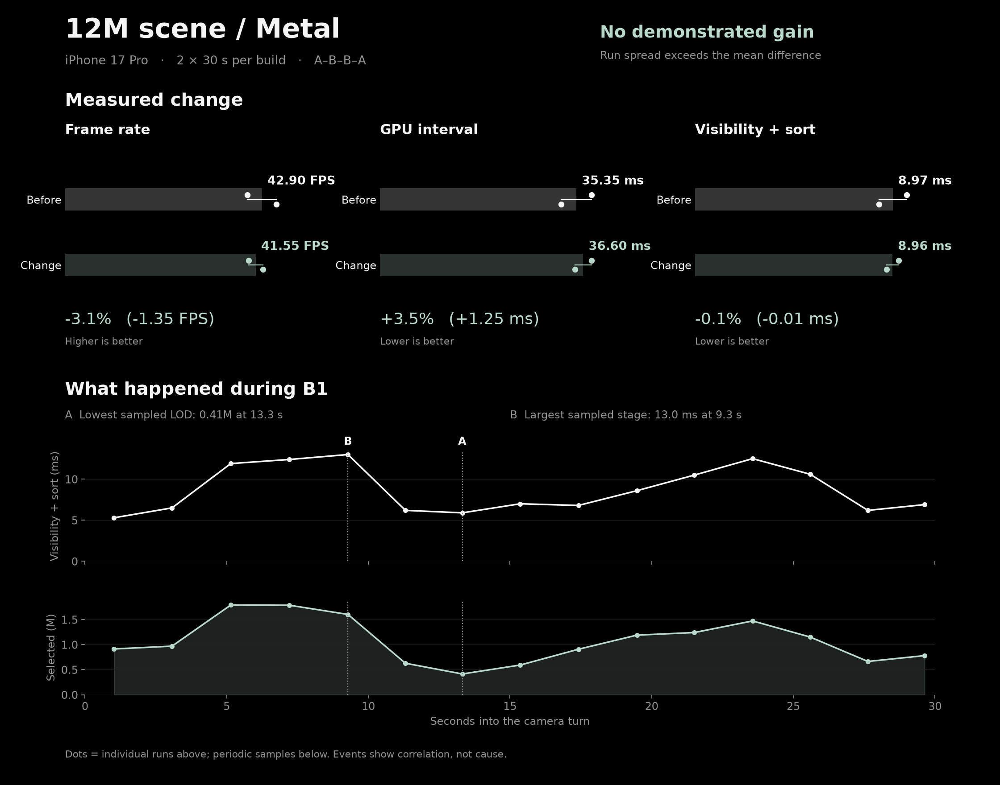

# Metal indexed visibility: PR #60

No demonstrated gain: 42.90 -> 41.55 FPS (-3.1%), with baseline repeats spanning 39.7-46.1 FPS.
The spread exceeds the mean difference; there is no isolated causal performance conclusion.



- [Comparison data, samples, provenance and limits](comparison.json).
- Before: [A1 report](A1.json), [log](A1.log); [A2 report](A2.json), [log](A2.log).
- Change: [B1 report](B1.json), [log](B1.log); [B2 report](B2.json), [log](B2.log).
- Warmups: [baseline](warmup-A2.json), [log](warmup-A2.log); [change](warmup-B.json), [log](warmup-B.log).
- Excluded attempt: [resource-monitor guard stop](warmup-A.json), [log](warmup-A.log).

## Reproduction

Build each recorded revision once as Release with `scripts/build-ios.sh Release`, then the iOS dev app with the same Xcode settings and Derived Data, serially.
Stage the resulting app directories at `build/pr60-ab/base.app` and `change.app`, with their full revisions in `base-commit.txt` and `change-commit.txt`.
[run.py](run.py) checks the embedded shader guard, records the installed binary hash and reuses the existing device world.
Run from the repository root; the recorded phone identifier is in the script.

```sh
python3 docs/benchmarks/2026-10-24-metal-visibility-12m-ab/run.py base warmup-A --seconds 10
python3 docs/benchmarks/2026-10-24-metal-visibility-12m-ab/run.py base A1
python3 docs/benchmarks/2026-10-24-metal-visibility-12m-ab/run.py change warmup-B --seconds 10
python3 docs/benchmarks/2026-10-24-metal-visibility-12m-ab/run.py change B1
python3 docs/benchmarks/2026-10-24-metal-visibility-12m-ab/run.py change B2
python3 docs/benchmarks/2026-10-24-metal-visibility-12m-ab/run.py base A2
```

Each output label must be new; copy its `report.json` and `console.log` beside this file as `<label>.json` and `<label>.log`.
Regenerate the chart offline with `python3 docs/benchmarks/2026-10-24-metal-visibility-12m-ab/plot.py` (requires matplotlib).
`run.commit` and `binary_sha256` identify the installed build; `driver_commit` and `dirty` describe the reporting checkout, which acquired evidence files while the prepared binaries stayed unchanged.

## Scope

Physical iPhone 17 Pro, A19 Pro, iOS 27.0.1; 11,988,085 source splats, 13,375,264 prepared nodes, SH1, high, 1.8M budget, subpixel 1, verified pose `-7.25,1.6,5.25,0,0`.
Each run is one fixed-position 360-degree turn over 30 seconds; this is not a path around the room.
World counts match the [reference fixture](../../VALIDATION.md#reference-performance-world); the on-device file hash was not independently measured.
GPU intervals may lag/repeat and do not sum across queues; visibility + sort is sampled, not isolated kernel timing.
Stage comparison excludes samples outside 0-30 seconds, zero drawn counts and unavailable zero stage values; raw reports retain their original summaries.
The first-frame effects remain in the full-window FPS/GPU summaries.
The optional resource monitor stopped the first warmup at its fixed 2800 MiB guard; both measured variants ran without that monitor.
Two repeats and no matched thermal trace establish neither sustained acceptance nor a causal regression; battery, energy and bandwidth are unmeasured.
Markers A/B identify observations in [B1.log](B1.log), not causes: the lowest sampled selection and the largest sampled visibility + sort interval.
Detailed Metal System Trace and GPU frame capture were not collected for these four runs.
